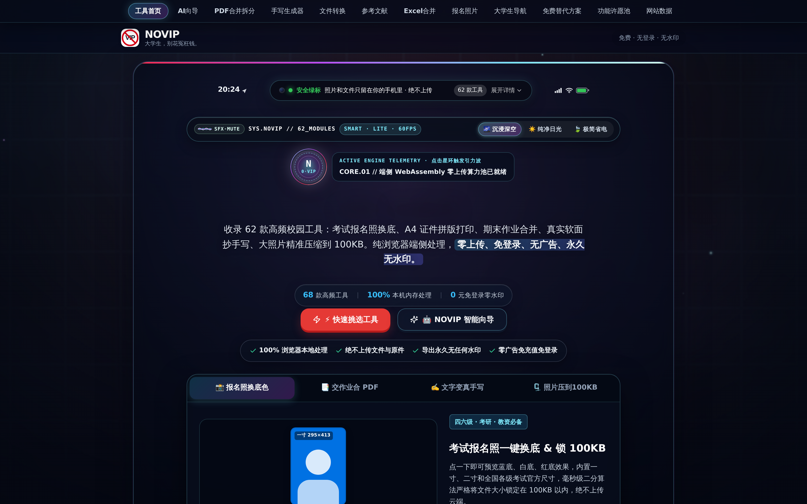
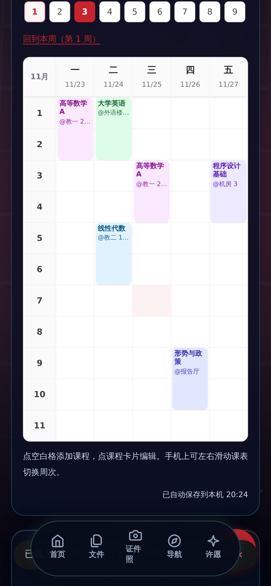

# NOVIP · 大学生免费工具箱

**大学生，别花冤枉钱。**

[在线体验 NOVIP](https://novip.site) · [查看工具库](https://novip.site/) · [反馈与功能建议](https://novip.site/)

NOVIP 是面向大学生日常学习与校园生活的免费工具站，基于 **React / TypeScript / Vite**。主打 **无需强制登录、不加下载水印、尽量在浏览器本地完成文件处理**。

> **版本说明：** 当前仓库源码注册了 **72 个公开工具入口**（NOVIP 2.0 代码）。生产站点可能因手动部署及 CDN 缓存仍显示旧版，**代码合并成功不代表 novip.site 已经上线**。

## 可以做什么

- **文件与 PDF：** 合并/拆分 PDF、压缩、按页处理、格式转换、课程资料整理。
- **图片与报名：** 一寸/二寸报名照、换底色、图片精准压缩到目标 KB、A4 证件拼版。
- **学习与写作：** 手写模拟、论文和课程 PPT、引用处理、课程表、错题复习。
- **校园计算：** GPA 与期末成绩反推、生活费预算、实习工时、考试倒计时。
- **日常效率：** 任务四象限、番茄钟、论文答辩测速等。

实际可用功能和处理边界以每个工具页面的说明为准。部分在线或 AI 功能可能需要网络；请勿把“多数文件功能本地处理”误解为所有服务均离线运行。

## 真机尺寸截图（网页原生截图）

以下图片由 Playwright + Chromium 在公开网站上采集；分别采用电脑 **3200×2000** 和手机 **1170×2532** 分辨率，均不是生成式 AI 绘制的界面。

<p>
  
  
</p>

- [完整电脑端展示](docs/screenshots/desktop-timetable.png)
- [完整手机端展示](docs/screenshots/mobile-grades.png)
- [截图制作说明](docs/SHOWCASE-SCREENSHOTS.md)（支持重新自动截取，生成 GitHub Actions ZIP 产物）

## 本地开发

```bash
git clone https://github.com/stevengongqwe-code/novip-open.git
cd novip-open
node scripts/recover-assets.mjs
npm ci
npm run dev
```

**注意：** 部分第三方资产和品牌素材并未提交到仓库。`package.json` 通过 `file:vendor/xlsx-0.20.3.tgz` 引用 SheetJS，而 `vendor/` 与 `public/` 下的生产字体、Logo、作者二维码都不在本快照内，所以**直接 `npm ci` 会失败**。正式构建前请先查看 [可复现构建说明](docs/BUILD.md)，用 `scripts/recover-assets.mjs` 补齐必要资产，再运行 `npm run typecheck`、`npm test` 和 `npm run build`。

**构建状态说明：** 本公开快照在发布时**没有**执行完整构建（缺上述资产，补齐需联网下载第三方 CDN 文件与本站生产静态资源），因此这里不声明构建已通过。`docs/BUILD.md` 记录的是构建链与已知缺口，不是构建成功证明。

## 隐私、安全和部署

文件处理默认优先使用浏览器本地能力；上传文件前请阅读目标工具的隐私说明。安全问题不建议公开发布可利用细节或真实凭证。

本仓库是**不含历史提交的源码快照**：线上生产站点的部署配置、CI 部署凭据与开发历史都留在私有开发仓中，不在本仓库内，本仓库也无法触发生产部署。部署到自己的环境需要自行准备托管与配置，参见 [构建说明](docs/BUILD.md)。

## License

本项目仓库包含 [MIT License](LICENSE)。品牌名称、Logo 和第三方素材的权利请分别核对适用说明及第三方许可文件。

---

如果 NOVIP 对你有帮助，欢迎给公开的源码仓库一个 **Star**，或者提出一个大学生活里真正需要的工具。
